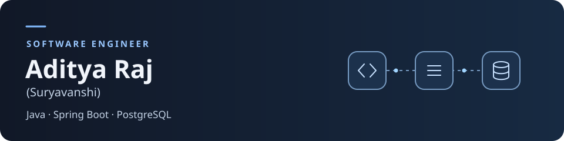
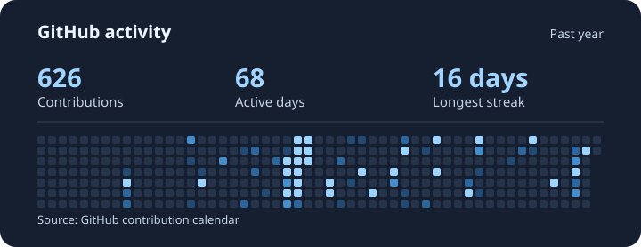

<picture>
  <source media="(prefers-reduced-motion: reduce)" srcset="./assets/backend-header-static.svg">
  
</picture>

I’m Aditya Raj, a software engineer based in Riga, Latvia. I build backend services with Java, Spring Boot, and PostgreSQL, and use Python for API-driven applications.

I built the backend for Spark, developed the order service for a Dockerized e-commerce microservices project, and built SkyPath, a Python and Flask flight tracker.

[Portfolio](https://aditya-portfolio-web-amber.vercel.app/) · [LinkedIn](https://www.linkedin.com/in/aditya535/)

### ◇ Tech stack

### ▣ Featured work

| Project | What I built |
| :--- | :--- |
| **[Spark Architecture](https://github.com/aadi535/spark-architecture)** · [Earlier web preview](https://spark-app-virid.vercel.app/) | My thesis project. Built the Java and Spring Boot backend with REST APIs and PostgreSQL for Android microlearning. |
| **[Apex E-Commerce](https://github.com/aadi535/aditya-sdk-ecommerce-new)** · [Live storefront](https://apex-ecommerce-aditya.vercel.app/) | Built the Java and Spring Boot order service for a Dockerized e-commerce system. |
| **[SkyPath](https://github.com/aadi535/SkyPath-Live-Flight-Tracking-made-by-Aditya)** · [Live map](https://skypath-flight-explorer.vercel.app/) | Built a Python and Flask flight map with a labelled synthetic fallback when live data is unavailable. |
| **[Blockchain Certificate Verification](https://github.com/aadi535/blockchain-certificate-dapp)** | Solidity and MetaMask demo for issuing and verifying sample certificates by ID. |
| **[SpaceX Launch Dashboard](https://github.com/aadi535/spacex-dashboard)** | Streamlit dashboard for filtering historical launches and comparing mission outcomes. |

### ◈ Development metrics

[View my GitHub contributions](https://github.com/aadi535#contribution-activity) · [Browse public repositories](https://github.com/aadi535?tab=repositories)
