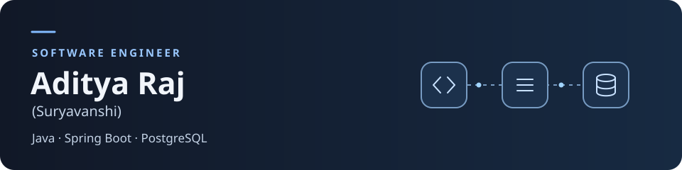
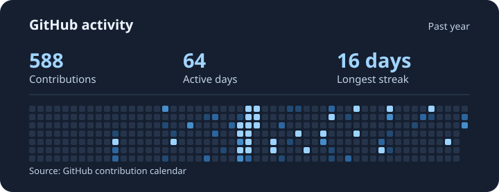

<picture>
  <source media="(prefers-reduced-motion: reduce)" srcset="./assets/backend-header-static.svg">
  
</picture>

I’m Aditya Raj, a software engineer based in Riga, Latvia. I build backend services with Java, Spring Boot, and PostgreSQL, and use Python for API-driven applications.

I built the backend for Spark, developed the order service for a Dockerized e-commerce microservices project, and built SkyPath, a Python and Flask flight tracker.

[Portfolio](https://aditya-portfolio-web-amber.vercel.app/) · [LinkedIn](https://www.linkedin.com/in/aditya535/)

### ◇ Tech stack

### ▣ Featured work

| Project | What I built |
| :--- | :--- |
| **[Spark for Android](https://spark-app-virid.vercel.app/)** · Earlier web preview | Built the Java and Spring Boot backend with REST APIs and PostgreSQL for an AI-powered Android learning app. |
| **[SkyPath — Live Flight Tracking](https://github.com/aadi535/SkyPath-Live-Flight-Tracking-made-by-Aditya)** | Built a Python and Flask flight tracker that uses an external API and switches to demo data when live data is unavailable. |
| **[Microservices E-Commerce System](https://github.com/aadi535/aditya-sdk-ecommerce-new)** | Built the Java and Spring Boot order service for a Dockerized e-commerce system and connected it to other services through REST APIs. |

### ◈ Development metrics

[View my GitHub contributions](https://github.com/aadi535#contribution-activity) · [Browse public repositories](https://github.com/aadi535?tab=repositories)
